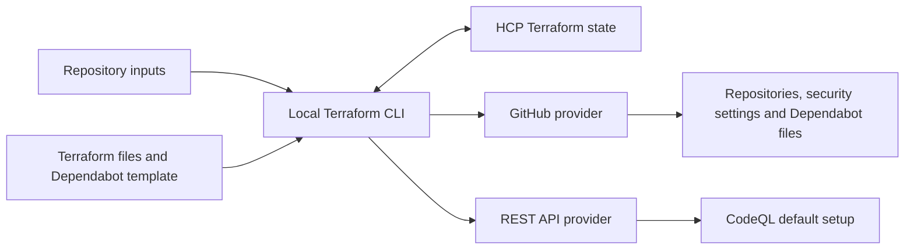

# Portfolio Project Bootstrap

Terraform automation for creating GitHub repositories and managing a
consistent repository security baseline.

## Terraform skills demonstrated

| Concept or practice | Application in this project | Evidence |
| --- | --- | --- |
| Typed inputs and defaults | A map of repository objects defines reusable inputs, with optional attributes for readiness, dependency directories and security features. | [variables.tf](variables.tf) |
| Resource iteration and dependencies | `for_each` manages multiple repositories; chained resource maps establish dependencies between repositories, vulnerability alerts and security updates. | [repositories.tf](repositories.tf), [security.tf](security.tf) |
| Local values and filtered expressions | Filtered `for` expressions select repositories ready for configuration and those eligible for CodeQL setup. | [locals.tf](locals.tf), [codeql.tf](codeql.tf) |
| Conditional templates | `templatefile()`, interpolation and conditional directives generate Dependabot configuration for each repository's dependency ecosystems and directories. | [dependabot.tf](dependabot.tf), [template](templates/dependabot.yml.tftpl) |
| Multiple providers and API integration | The GitHub provider manages repository resources; the REST API provider manages CodeQL default setup using JSON request bodies built with `jsonencode()`. | [providers.tf](providers.tf), [codeql.tf](codeql.tf) |
| Declarative imports | Import blocks bring existing repositories and security settings under Terraform management. | [imports.tf](imports.tf) |
| Data sources and derived outputs | A data source reads the authenticated GitHub identity; a `for` expression produces repository SSH URLs keyed by name. | [identity.tf](identity.tf), [outputs.tf](outputs.tf) |
| Remote state and drift reconciliation | HCP Terraform stores state separately from local execution. Verification demonstrates detecting and correcting a deliberately changed setting. | [backend.tf](backend.tf), [verification](VERIFICATION.md) |
| Reproducible tooling and CI | Pinned Terraform and provider versions, a committed provider lock file and GitHub Actions support consistent formatting and configuration validation. | [versions.tf](versions.tf), [lock file](.terraform.lock.hcl), [workflow](.github/workflows/terraform-checks.yml) |

## Verified outcomes

Repository creation has been verified on Fyyur and Trivia API, and the
existing asteroid-approach-explorer repository (Neo) has been adopted.

All three repositories use Terraform-managed Dependabot alerts and security
updates, weekly dependency updates, security-update grouping rules, secret
scanning, push protection and CodeQL default setup. Issues are enabled;
Projects and Wiki are disabled.

This bootstrap repository is also managed by the configuration, with weekly
Terraform dependency updates and the shared repository security settings.
CodeQL default setup is disabled for this repository through
`codeql_enabled = false`.

The complete two-stage creation workflow has been verified on Trivia API.
Drift detection and reconciliation have also been demonstrated. A final
Terraform plan reported no changes across all four repositories.
See [VERIFICATION.md](VERIFICATION.md) for the recorded evidence.

## Architecture

Terraform runs locally on Ubuntu, with state stored in HCP Terraform.



GitHub Actions checks formatting and configuration validity.
Plans and applies remain reviewed local operations.

## Ownership and verification

Terraform manages repository identity, description, visibility,
Dependabot alerts and security updates, secret scanning and push protection.

Terraform owns `.github/dependabot.yml` after existing content has
been inspected and reconciled. Subsequent deliberate changes to this
file must also be reflected in the Terraform configuration.

Terraform manages CodeQL default setup through the Mastercard REST API
provider, using GitHub's default query suite and standard runners.
GitHub selects the analysis languages. Applying removal of the CodeQL
resource disables default setup.

`codeql_enabled` defaults to `true`. Set it to `false` for repositories
where CodeQL setup is not applicable. Changing an already managed
repository to `false` proposes removing its CodeQL resource and disabling
default setup.

Application code, tests, dependencies and development workflows remain
owned by the consuming project. Local Git connection, initial publication
and checkout synchronisation are manual. Python environments and
development tooling remain outside this Terraform project's scope.

For a new repository, `content_ready` defaults to `false`. The first
reviewed apply creates the repository and its repository-level settings,
while deferring the Dependabot file and CodeQL setup. After manually
publishing the scaffold as `main`, set `content_ready = true`, review and
apply a fresh plan, then synchronise the local checkout.

Existing populated repositories explicitly use `content_ready = true`.
Keep this value after setup: changing it to `false` proposes removing the
Dependabot file and disabling CodeQL.

The staged workflow was verified on Trivia API while preserving its supplied
scaffold history, original remote and application files. The local checkout
was then synchronised with the Terraform-created Dependabot commit.

When adopting existing resources, inspect and import them before applying changes.
Adoption must include review of other repository properties controlled
by the same Terraform resource.

Completion requires verified GitHub controls, a subsequent Terraform plan
with no changes, and preservation of unrelated settings and application
content.

## Dependency update directories

Each repository accepts these optional inputs:

| Input | Default | Purpose |
| --- | --- | --- |
| `pip_enabled` | `true` | Include Python dependency updates |
| `pip_directory` | `"/"` | Directory containing Python dependency files |
| `npm_directory` | `null` | Directory containing npm dependency files; omitted from Dependabot when unset |
| `terraform_directory` | `null` | Directory containing Terraform configuration; omitted from Dependabot when unset |

Directory paths are relative to the repository root and start with `/`.
GitHub Actions updates always use `/`.

For example, Trivia API uses:

```hcl
pip_directory = "/backend"
npm_directory = "/frontend"
```

Terraform renders `templates/dependabot.yml.tftpl` and publishes the result
as `.github/dependabot.yml` in each ready repository.

## Example inputs

[terraform.tfvars.example](terraform.tfvars.example) demonstrates three layouts:

- A Python repository using the default dependency directory.
- A Flask/React repository with separate backend and frontend directories.
- A Terraform repository with Python updates and CodeQL disabled.

Terraform does not load the example file automatically. Use it as a reference
when editing your local `terraform.tfvars`.

Preserve existing managed repository entries. Removing an entry can propose
deleting that repository and its associated resources.

This root configuration uses account-specific GitHub ownership, HCP workspace
settings and import blocks. Review `providers.tf`, `backend.tf` and `imports.tf`
before adapting it for another account.

## Reviewed plan and apply

Run commands from the bootstrap project root after configuring inputs and
authentication. Initialise a fresh checkout with `terraform init`.

Load the logging helper and save a plan:

```bash
source scripts/aliases.sh
lg terraform plan -out=tmp/repository-setup.tfplan
```

Review the target repositories and every proposed creation, import, update
or deletion. Resolve unexpected changes before applying.

Apply the reviewed saved plan:

```bash
lg terraform apply tmp/repository-setup.tfplan
```

Applying a saved plan does not prompt for approval again. If inputs,
configuration or state change, generate and review a fresh plan.

For new repositories, perform this sequence first with `content_ready = false`.
Publish the scaffold manually, set readiness to `true`, then repeat the
plan/review/apply sequence. Existing resources require the appropriate
adoption steps before applying.

Synchronise local checkouts with any Terraform-created commits, then
check for convergence:

```bash
lg terraform plan
```

The expected result is no changes.

## Continuous integration

The [Terraform checks workflow](.github/workflows/terraform-checks.yml)
runs on pull requests and pushes to `main`. It checks formatting,
installs the locked providers without initialising the HCP backend,
and validates the Terraform configuration.

CI uses Terraform 1.16.6 and read-only repository permissions. It requires
no personal GitHub or HCP credentials and does not run plans or applies.
Reviewed plans and applies remain local operations.

The committed provider lock file includes checksums for both the Ubuntu
ARM64 development VM and the Linux AMD64 CI runner. When deliberately
updating provider versions, refresh both platforms:

```bash
terraform providers lock -platform=linux_arm64 -platform=linux_amd64
```

References: [Terraform validation](https://developer.hashicorp.com/terraform/cli/commands/validate),
[provider locking across platforms](https://developer.hashicorp.com/terraform/cli/commands/providers/lock#specifying-target-platforms),
and [setup-terraform](https://github.com/hashicorp/setup-terraform).

## GitHub API authentication

Authenticate with GitHub CLI before running Terraform. The GitHub provider
can reuse that login. The REST API provider requires its token in the
current terminal session:

```bash
REST_API_BEARER="$(gh auth token --hostname github.com)" &&
export REST_API_BEARER
```

Run this directly, without logging token retrieval. The token is supplied
through the environment rather than committed configuration.

## Required access

GitHub credentials must permit the intended repository creation, configuration
file writes and security-setting changes. Access must cover every repository
in the input map.

Manual Git publication over SSH requires separate SSH authentication.
HCP Terraform credentials must authorise access to the configured workspace
and its state.

## Terraform state

State storage: HCP Terraform.
Execution: local, on the Ubuntu development machine.

- Organisation: `victor-gb-portfolio`
- Workspace: `portfolio-project-bootstrap`
- Workspace execution mode: Local (custom)

Terraform CLI authentication is stored outside this repository.
Credentials, state files and local repository inputs must not be committed.

## Reconnecting from a replacement machine

Restore the configuration and the intended local `terraform.tfvars`.
Install the pinned Terraform version and authenticate with GitHub.

Load `REST_API_BEARER` in that terminal using the authentication instructions above.

Run `terraform login`, then `terraform init` to reconnect to the existing
HCP workspace. Run `terraform plan` and review it before applying changes.

Reconnecting requires access to the HCP account and workspace.
It does not require recreating repositories already recorded in that state.
